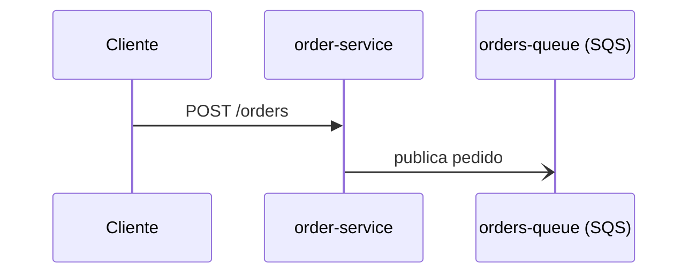

# project-documenter

Plugin do Claude Code que documenta projetos com diagramas **Mermaid** e **draw.io**.

Em vez de gerar o diagrama direto, ele primeiro **lê o código e escreve o fluxo em linguagem natural** (`flow.md`) para você corrigir e aprovar. Só depois gera os diagramas, derivados desse texto. Quando o código muda, ele diz quais diagramas ficaram desatualizados.

## Instalação (teste local)

```bash
claude --plugin-dir /caminho/para/project-documenter
```

Rode isso dentro (ou apontando para) o projeto que você quer documentar. O plugin traz:

| Peça | Nome | Para que serve |
|---|---|---|
| Command | `/diagram` | Conduz o fluxo todo: perguntas, análise, aprovação, geração, índice |
| Agent | `project-analyst` | Lê o código em contexto isolado e escreve o `flow.md` |
| Skill | `mermaid` | Gera diagramas Mermaid (sequência, fluxo, arquitetura simples) |
| Skill | `drawio` | Gera arquivos `.drawio` (arquitetura, infra e deploy, AWS, caminho da requisição) |

## Como usar

### 1. Documentar um projeto: `/diagram`

```
/diagram
```

O command faz, nesta ordem (e **para nos gates** esperando você):

1. **Perguntas** (uma por vez): escopo, foco e público.
2. **Análise**: o `project-analyst` lê o código e devolve um resumo curto.
3. **Gate: `flow.md`**. Você lê `docs/diagrams/<escopo>/flow.md`, edita à mão ou pede ajustes, e aprova.
4. **Tipo e formato**: você escolhe os tipos de diagrama; ele sugere o formato padrão.
5. **Geração**: a skill do formato escreve o `.mmd` ou `.drawio`.
6. **Índice**: registra tudo em `INDEX.md`, com hashes para detectar mudanças depois.

Exemplo ilustrativo de uma conversa (as falas reais variam):

```
você:    /diagram
claude:  Qual o escopo? Repositório inteiro ou um serviço/módulo?
você:    o serviço orders/
claude:  Qual o foco? (um fluxo específico ou visão geral)
você:    criação de pedido
claude:  Para quem é a documentação? (time técnico, novos devs, negócio)
você:    time técnico
claude:  [analisa o código] Escrevi docs/diagrams/orders/flow.md.
         Achei 2 componentes e 1 fluxo. Lacuna: nenhum consumidor da fila.
         Leia o arquivo e me diga se aprova ou o que corrigir.
você:    aprovado
claude:  Quais diagramas? arquitetura (draw.io), sequência (mermaid), ...
você:    arquitetura e sequência
claude:  Gerei architecture-orders.drawio (validado) e sequence-criar-pedido.mmd
         (não validado: mmdc não está instalado). Índice atualizado.
```

**Monorepo:** o command não aceita "tudo". Ele pede um serviço ou módulo por vez.

### 2. O que sai: exemplos

**`flow.md`**: o texto que você aprova. Os 6 títulos são fixos, e tudo cita o arquivo de origem. O que não foi verificado leva `[inferido]`, e o que não foi achado vai em Lacunas:

```markdown
# orders — Fluxo

## Visão geral
Serviço HTTP que recebe pedidos e os publica numa fila SQS. `src/routes.ts:7-11`

## Componentes
- **order-service** (TypeScript, Express) — recebe `POST /orders`. `src/routes.ts:7`
- **orders-queue** (SQS) — fila de pedidos. `infra/sqs.tf:1-3`

## Fluxos principais
### Criar pedido
1. O cliente chama `POST /orders`. `src/routes.ts:7`
2. O serviço publica o pedido em `orders-queue`. `src/routes.ts:9`

## Integrações externas
Nada encontrado.

## Infra e deploy
Uma fila SQS `orders-queue`. `infra/sqs.tf:1-3`

## Lacunas e dúvidas
- Nenhum consumidor de `orders-queue` foi encontrado.
```

**Diagrama Mermaid** (`sequence-criar-pedido.mmd`), gerado a partir da seção `Fluxos principais › Criar pedido`:



**Diagrama draw.io** (`architecture-orders.drawio`): XML mxGraph que você abre no [draw.io](https://app.diagrams.net) e ajusta. Um arquivo completo e válido está em [`skills/drawio/references/sample.drawio`](skills/drawio/references/sample.drawio). O **caminho da requisição** (uma requisição atravessando as etapas de um gateway até vários backends, cada um em sua coluna) tem molde próprio em [`skills/drawio/references/request-path-sample.drawio`](skills/drawio/references/request-path-sample.drawio).

**Índice** (`INDEX.md`): uma linha por diagrama, com os hashes da seção de origem e do arquivo:

```markdown
| Diagrama | Tipo | Formato | Origem | Gerado em | Hash origem | Hash arquivo |
|---|---|---|---|---|---|---|
| sequence-criar-pedido.mmd | sequência | mermaid | Fluxos principais › Criar pedido | 2026-10-04 | 06779fc8d18a | 100e1969da4a |
```

### 3. Formato padrão por tipo

Você pode trocar o formato a qualquer momento.

| Tipo | Seção do `flow.md` de origem | Formato padrão |
|---|---|---|
| sequência | Fluxos principais (um `###` por fluxo) | mermaid |
| fluxo e processo | Fluxos principais | mermaid |
| arquitetura | Componentes + Integrações externas | drawio |
| infra e deploy | Infra e deploy + Componentes | drawio |

Mermaid não tem ícones AWS nem grupos de conta, região e VPC. Para infra, o draw.io é a melhor escolha.

### 4. Atualizar depois que o código mudou: `/diagram update`

```
/diagram update
```

Ele roda `index_tool.py check` e mostra o estado de cada diagrama:

| Estado | Significa |
|---|---|
| `ok` | O diagrama bate com o `flow.md` |
| `desatualizado` | A seção de origem do `flow.md` mudou |
| `editado-à-mão` | Você mexeu no arquivo depois de gerado |
| `origem-removida` | A seção de origem não existe mais no `flow.md` |
| `arquivo-ausente` | O diagrama foi apagado |

**Regra de segurança:** um diagrama `editado-à-mão` só é regenerado com a sua confirmação explícita para aquele arquivo, porque a regeneração apaga as suas edições. Antes de reanalisar o código, o `flow.md` aprovado é copiado para `flow.md.prev` e você vê o diff.

### 5. Usar as skills sozinhas

Elas funcionam sem o `/diagram`, a partir de uma descrição sua:

```
faz um diagrama de sequência em mermaid do login: o app chama /login,
a API consulta o DynamoDB e devolve um token
```

```
monta um diagrama de arquitetura AWS em drawio: ALB, ECS, RDS e uma fila SQS,
dentro de uma VPC com subnets públicas e privadas
```

Sem o `flow.md`, elas não têm origem rastreável nem entram no índice. Servem para rascunhos rápidos.

## Scripts de apoio

Python 3, só stdlib. O plugin chama estes scripts, mas dá para usá-los sozinho:

```bash
# valida um .drawio: estrutura (XML, ids únicos, arestas ligadas a nós) e layout
# (seta atravessando nó, rota ortogonal provável cortando nó, rótulos repetidos, grupo sem filhos reais, grade de 10)
python3 scripts/validate_drawio.py arquivo.drawio
#   OK                                  exit 0
#   aviso: o texto do nó "..." provavelmente não cabe (≈4 linhas em 120x60px)   (exit 0)
#   aresta e1 (A -> C) atravessa o nó B                                         (exit 1)
#   aresta e2 (A -> C): a rota ortogonal provável atravessa o nó B              (aviso)

# rota EXATA das setas: renderiza com o CLI do draw.io e lê o SVG (seta por dentro de nó = erro)
python3 scripts/route_check.py arquivo.drawio
#   erro: a seta e3 (A -> C) passa por dentro do nó B                  (exit 1)
#   aviso: 2 cruzamento(s) entre setas: e1×e13, e2×e13                  (exit 0)
#   o diagrama não foi renderizado (CLI `drawio` ausente ou falhou)     (exit 3)

# registra um diagrama no índice e confere o estado
python3 scripts/index_tool.py add docs/diagrams/orders sequence-criar-pedido.mmd "sequência" mermaid "Fluxos principais › Criar pedido"
python3 scripts/index_tool.py check docs/diagrams/orders
#   sequence-criar-pedido.mmd    ok
#   sequence-criar-pedido.mmd    editado-à-mão+desatualizado
```

A origem pode juntar várias seções com ` + `, por exemplo `"Componentes + Integrações externas"`. O hash cobre todas elas.

## Desenvolvimento

```bash
python3 -m unittest discover -s tests -v   # 140 testes: scripts e estrutura do plugin
claude plugin validate .                   # valida o manifesto
```

### Evals

`evals/` tem três suítes, que rodam com e sem o plugin e comparam as notas: 6 casos do agent `project-analyst` (`01-…` a `06-…`), 5 da skill `drawio` (`drawio-01-…` a `drawio-05-…`) e 5 da skill `mermaid` (`mermaid-01-…` a `mermaid-05-…`). Cada skill tem um caso negativo (a skill **não** deve disparar no pedido do outro formato). Use `--case "drawio-*"`, `--case "mermaid-*"` ou `--case "0[1-6]-*"` para rodar só uma. Os casos da `mermaid` não usam shell (sem `Bash`), então rodam normalmente mesmo com o sandbox quebrado. Cada run é um `claude` completo na sua credencial e **custa dinheiro**: a suíte completa com 3 runs e baseline custou cerca de US$ 5,90.

```bash
# um caso só, 1 run, só com plugin (barato, ~US$ 0,10 a 0,30)
claude plugin eval . --case 05-monorepo-scope --runs 1 --ablation none \
  --no-publish --allow-tools Write --judge-model opus --max-cost-usd 1

# suíte completa, guardando traces para medir tokens
claude plugin eval . --no-publish --allow-tools Write --judge-model opus \
  --max-cost-usd 7 -j 3 --keep-temp --json resultado.json

# tokens por caso e braço (entrada e cache são confiáveis; "saída" é só um piso)
python3 scripts/eval_tokens.py resultado.json
```

**Organização dos diagramas `.drawio`:** os graders embutidos do eval não executam scripts, então o linter de layout roda depois, sobre os arquivos guardados:

```bash
claude plugin eval . --case "drawio-*" --keep-temp --no-publish --judge-model opus \
  --allow-tools Write "Bash(python3 \"$PWD/scripts/validate_drawio.py\":*)" --max-cost-usd 3 --json drawio.json
python3 scripts/eval_lint.py drawio.json     # erros e avisos de layout por caso e braço
python3 scripts/eval_lint.py drawio.json --render   # + rota exata (renderiza cada .drawio; precisa do CLI do draw.io)
# o Bash liberado é só o validador, com o caminho exato. Os casos em evals/drawio-*/prompt.md têm o
# caminho desta máquina: em outra máquina, troque com sed -i 's#/home/danilo/Workspace/project-documenter#<seu caminho>#' evals/drawio-*/prompt.md
```

Sempre passe `--no-publish`: sem isso o relatório pode ser publicado no claude.ai.

## Limitações conhecidas

- **O `/diagram` ainda não foi testado de ponta a ponta com um usuário real.** Os gates e os prompts estão no markdown e não têm teste automatizado.
- **A skill `mermaid` tem casos de eval escritos, mas nunca rodados.** A skill `drawio` foi avaliada (piloto de 1 caso). O validador do `.drawio` pega setas retas atravessando caixas e texto que estoura o nó, mas **não julga estética** e só checa setas roteadas quando origem e destino estão alinhados. Um diagrama com `OK` ainda pode ter curvas feias: abra no draw.io. Ícone AWS com nome errado aparece em branco e o validador não pega.
- Sem `mmdc` (mermaid-cli), o Mermaid sai **sem validação de sintaxe**, e o plugin avisa. Sem o CLI do draw.io, ele não exporta PNG, SVG ou PDF: entrega só o `.drawio`.
- Os títulos do `flow.md`, os estados do índice e as mensagens estão em português.
- Fora da v1: diagramas ER, de classes e Gantt, hooks que atualizam diagramas a cada commit.

## Estrutura

```
.claude-plugin/plugin.json     manifesto
commands/diagram.md            /diagram
agents/project-analyst.md      análise do código -> flow.md
skills/mermaid/                SKILL.md + references/{sequence,flow,architecture}.md
skills/drawio/                 SKILL.md + references/{layout,architecture,infra-aws}.md + sample.drawio
scripts/                       validate_drawio.py, index_tool.py, eval_tokens.py
evals/                         6 casos de eval do project-analyst
tests/                         testes e fixtures
docs/superpowers/              spec e plano de implementação
```
