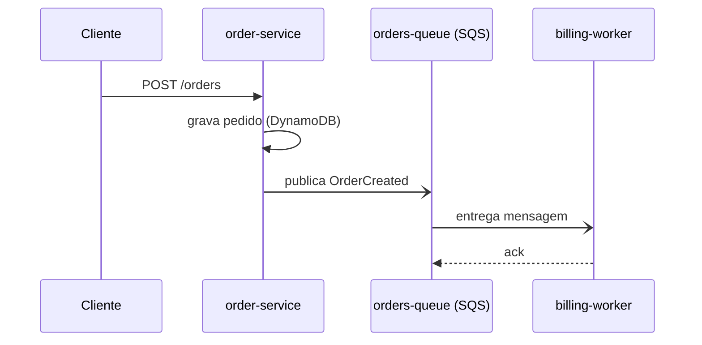
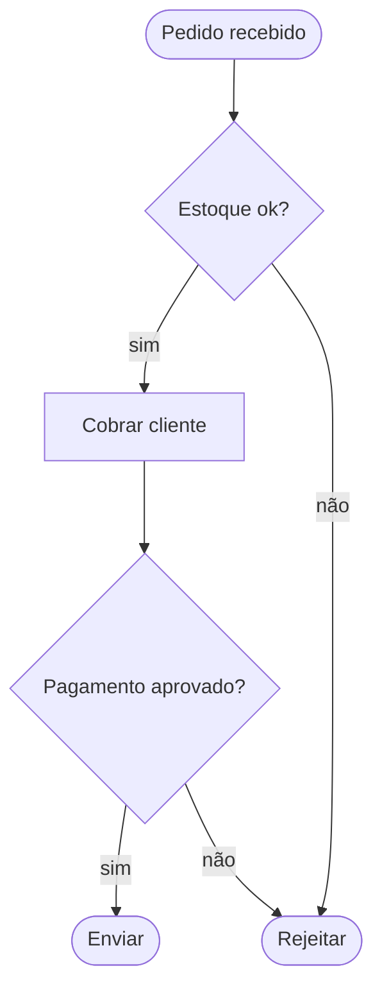
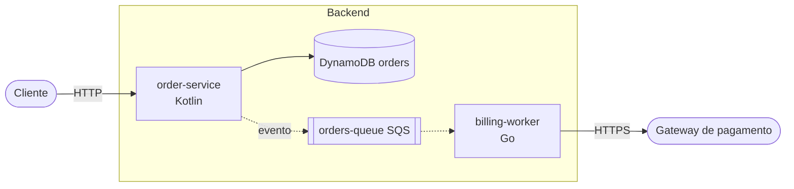

# project-documenter Implementation Plan

> **For agentic workers:** REQUIRED SUB-SKILL: Use superpowers:subagent-driven-development (recommended) or superpowers:executing-plans to implement this plan task-by-task. Steps use checkbox (`- [ ]`) syntax for tracking.

**Goal:** Construir o plugin `project-documenter` do Claude Code: o command `/diagram` conduz perguntas, análise do código e um `flow.md` aprovado pelo usuário, e depois gera diagramas Mermaid ou draw.io.

**Architecture:** O plugin é quase todo markdown (command, agent e duas skills), e a parte determinística fica em dois scripts Python (stdlib) com testes: `validate_drawio.py` valida o XML do draw.io, e `index_tool.py` mantém o `INDEX.md` com hashes. O command conduz o diálogo, o agent `project-analyst` lê o código em contexto isolado, e as skills `mermaid` e `drawio` carregam `references/` sob demanda.

**Tech Stack:** Markdown com frontmatter (formato de plugin do Claude Code), Python 3 stdlib (`unittest`, `xml.etree`, `hashlib`), git.

**Spec:** `docs/superpowers/specs/2026-10-02-project-documenter-design.md`

## Global Constraints

- Scripts em Python 3 usando **somente a stdlib** (sem pip install).
- Saídas dos diagramas em `docs/diagrams/<escopo>/` do projeto analisado: `flow.md`, `INDEX.md`, `<tipo>-<nome>.mmd` ou `<tipo>-<nome>.drawio`.
- Seções do `flow.md`, exatamente com estes títulos: `Visão geral`, `Componentes`, `Fluxos principais`, `Integrações externas`, `Infra e deploy`, `Lacunas e dúvidas`.
- Cada afirmação do `flow.md` cita a origem (`arquivo:linha`); o não verificado leva `[inferido]`; o não encontrado vai em `Lacunas e dúvidas`.
- `project-analyst`: ferramentas só `Read, Grep, Glob, Write`; nunca executa o código do projeto.
- Mermaid: no máximo uns 15 nós por diagrama; IDs de nós estáveis.
- Formato padrão: Mermaid para sequência e fluxo, draw.io para arquitetura e infra; sempre sobrescrevível pelo usuário.
- Export PNG/SVG/PDF e validação `mmdc` só se o CLI existir; sem o CLI, avisar que não validou, nunca afirmar que validou.
- Diagrama editado à mão nunca é sobrescrito sem perguntar.
- A `description` de cada skill, command e agent tem no máximo 400 caracteres (fica sempre no contexto).
- Fora da v1: ER, classes, Gantt, hooks automáticos por commit, imagem sem CLI.

## Review Focus

1. `index_tool add` com origem inexistente no `flow.md`: erro claro e `INDEX.md` intacto (testado na Task 3).
2. `index_tool check` sem `INDEX.md`: mensagem clara, exit 0, sem traceback (Task 3).
3. Campo contendo `|` (quebraria a tabela do índice): rejeitado com erro (Task 3).
4. `.drawio` vazio, não-XML ou com raiz errada: erros claros e exit 1 (Task 2).
5. Projeto sem manifestos reconhecíveis: o `flow.md` traz `Lacunas e dúvidas` e **nenhum componente inventado** (fixture `empty-project`, Task 7).

---

## File Structure

```
.claude-plugin/plugin.json
commands/diagram.md
agents/project-analyst.md
skills/mermaid/SKILL.md
skills/mermaid/references/{sequence,flow,architecture}.md
skills/drawio/SKILL.md
skills/drawio/references/{architecture,infra-aws}.md
scripts/validate_drawio.py
scripts/index_tool.py
tests/test_structure.py
tests/test_validate_drawio.py
tests/test_index_tool.py
tests/fixtures/{ts-orders-api,empty-project}/…
README.md
```

Rodar toda a suíte: `python3 -m unittest discover -s tests -v`

---

### Task 1: Repositório, manifesto e teste de estrutura

**Files:**
- Create: `.claude-plugin/plugin.json`
- Create: `tests/test_structure.py`
- Create: `.gitignore`

**Interfaces:**
- Produces: `tests/test_structure.py` valida todo componente que existir (frontmatter, nomes, referências). As Tasks 4 a 6 dependem dele.

- [ ] **Step 1: Inicializar o git**

```bash
cd /home/danilo/Workspace/project-documenter
git init
printf '__pycache__/\n*.pyc\n' > .gitignore
```

- [ ] **Step 2: Escrever o teste de estrutura (deve falhar: plugin.json não existe)**

Create `tests/test_structure.py`:

```python
import json
import re
import unittest
from pathlib import Path

ROOT = Path(__file__).resolve().parent.parent


def frontmatter(path):
    text = path.read_text(encoding="utf-8")
    m = re.match(r"---\n(.*?)\n---\n", text, re.S)
    if not m:
        return None
    fm = {}
    for line in m.group(1).splitlines():
        if ":" in line and not line.startswith((" ", "\t")):
            k, v = line.split(":", 1)
            fm[k.strip()] = v.strip()
    return fm


class ManifestTest(unittest.TestCase):
    def test_plugin_json(self):
        data = json.loads((ROOT / ".claude-plugin" / "plugin.json").read_text())
        self.assertEqual(data["name"], "project-documenter")
        self.assertTrue(data["version"])
        self.assertTrue(data["description"])


class ComponentTest(unittest.TestCase):
    def test_commands_and_agents_have_description(self):
        for folder in ("commands", "agents"):
            for p in (ROOT / folder).glob("*.md"):
                fm = frontmatter(p)
                self.assertIsNotNone(fm, f"{p} sem frontmatter")
                self.assertTrue(fm.get("description"), f"{p} sem description")
                self.assertLessEqual(len(fm["description"]), 400, p)

    def test_agents_declare_name_and_tools(self):
        for p in (ROOT / "agents").glob("*.md"):
            fm = frontmatter(p)
            self.assertEqual(fm.get("name"), p.stem, p)
            self.assertTrue(fm.get("tools"), f"{p} sem tools")

    def test_skills(self):
        for skill in (ROOT / "skills").glob("*/SKILL.md"):
            fm = frontmatter(skill)
            self.assertIsNotNone(fm, f"{skill} sem frontmatter")
            self.assertEqual(fm.get("name"), skill.parent.name, skill)
            self.assertTrue(fm.get("description"), skill)
            self.assertLessEqual(len(fm["description"]), 400, skill)

    def test_skill_references_are_consistent(self):
        for skill in (ROOT / "skills").glob("*/SKILL.md"):
            text = skill.read_text(encoding="utf-8")
            linked = set(re.findall(r"references/([\w-]+\.md)", text))
            existing = {p.name for p in (skill.parent / "references").glob("*.md")}
            self.assertEqual(linked, existing, f"{skill}: links x arquivos divergem")


if __name__ == "__main__":
    unittest.main()
```

- [ ] **Step 3: Rodar e ver falhar**

Run: `python3 -m unittest tests.test_structure -v`
Expected: `test_plugin_json` falha com `FileNotFoundError` (os outros passam vazios).

- [ ] **Step 4: Criar o manifesto**

Create `.claude-plugin/plugin.json`:

```json
{
  "name": "project-documenter",
  "version": "0.1.0",
  "description": "Documenta projetos: analisa o código, escreve o fluxo em linguagem natural e gera diagramas Mermaid e draw.io."
}
```

- [ ] **Step 5: Rodar e ver passar**

Run: `python3 -m unittest tests.test_structure -v`
Expected: 5 testes `OK`.

- [ ] **Step 6: Commit**

```bash
git add .
git commit -m "chore: scaffold plugin manifest and structure tests" -m "Co-Authored-By: Claude Sonnet 5.5 <noreply@anthropic.com>"
```

---

### Task 2: Validador de `.drawio`

**Files:**
- Create: `scripts/validate_drawio.py`
- Test: `tests/test_validate_drawio.py`

**Interfaces:**
- Produces: `validate(path: str | Path) -> list[str]` (lista vazia = válido). CLI: `python3 scripts/validate_drawio.py <arquivo.drawio>`, que imprime um erro por linha e sai com exit 1 se houver erro, ou imprime `OK` com exit 0.

- [ ] **Step 1: Escrever os testes que falham**

Create `tests/test_validate_drawio.py`:

```python
import subprocess
import sys
import tempfile
import unittest
from pathlib import Path

ROOT = Path(__file__).resolve().parent.parent
sys.path.insert(0, str(ROOT / "scripts"))
from validate_drawio import validate  # noqa: E402

GOOD = """<mxfile><diagram name="p1"><mxGraphModel><root>
<mxCell id="0"/><mxCell id="1" parent="0"/>
<mxCell id="a" value="A" vertex="1" parent="1"><mxGeometry x="0" y="0" width="80" height="40" as="geometry"/></mxCell>
<mxCell id="b" value="B" vertex="1" parent="1"><mxGeometry x="200" y="0" width="80" height="40" as="geometry"/></mxCell>
<mxCell id="e1" edge="1" source="a" target="b" parent="1"><mxGeometry relative="1" as="geometry"/></mxCell>
</root></mxGraphModel></diagram></mxfile>"""


def write(text):
    f = tempfile.NamedTemporaryFile("w", suffix=".drawio", delete=False, encoding="utf-8")
    f.write(text)
    f.close()
    return f.name


class ValidateTest(unittest.TestCase):
    def test_valid_file(self):
        self.assertEqual(validate(write(GOOD)), [])

    def test_not_xml(self):
        errs = validate(write("isto não é xml"))
        self.assertEqual(len(errs), 1)
        self.assertIn("XML mal formado", errs[0])

    def test_empty_file(self):
        errs = validate(write(""))
        self.assertIn("XML mal formado", errs[0])

    def test_wrong_root(self):
        errs = validate(write("<foo/>"))
        self.assertIn("raiz deve ser <mxfile>", errs)

    def test_duplicate_id(self):
        errs = validate(write(GOOD.replace('id="b"', 'id="a"', 1).replace('target="b"', 'target="a"')))
        self.assertTrue(any("id duplicado: a" in e for e in errs))

    def test_edge_to_missing_node(self):
        errs = validate(write(GOOD.replace('target="b"', 'target="zzz"')))
        self.assertTrue(any("target inválido: zzz" in e for e in errs))

    def test_same_id_in_different_pages_is_ok(self):
        two = GOOD.replace("</mxfile>", GOOD[GOOD.index("<diagram"):])
        self.assertEqual(validate(write(two)), [])

    def test_cli_exit_codes(self):
        script = str(ROOT / "scripts" / "validate_drawio.py")
        ok = subprocess.run([sys.executable, script, write(GOOD)], capture_output=True, text=True)
        self.assertEqual((ok.returncode, ok.stdout.strip()), (0, "OK"))
        bad = subprocess.run([sys.executable, script, write("<foo/>")], capture_output=True, text=True)
        self.assertEqual(bad.returncode, 1)


if __name__ == "__main__":
    unittest.main()
```

- [ ] **Step 2: Rodar e ver falhar**

Run: `python3 -m unittest tests.test_validate_drawio -v`
Expected: `ModuleNotFoundError: No module named 'validate_drawio'`

- [ ] **Step 3: Implementar**

Create `scripts/validate_drawio.py`:

```python
#!/usr/bin/env python3
"""Valida um arquivo .drawio: XML bem formado, IDs únicos por página, arestas com nós existentes."""
import sys
import xml.etree.ElementTree as ET


def validate(path):
    try:
        root = ET.parse(path).getroot()
    except (ET.ParseError, OSError) as e:
        return [f"XML mal formado: {e}"]
    if root.tag != "mxfile":
        return ["raiz deve ser <mxfile>"]
    errors = []
    diagrams = list(root.iter("diagram"))
    if not diagrams:
        errors.append("nenhum <diagram> encontrado")
    for diagram in diagrams:
        name = diagram.get("name", "?")
        cells = list(diagram.iter("mxCell"))
        ids = set()
        for cell in cells:
            cid = cell.get("id")
            if cid is None:
                errors.append(f"[{name}] mxCell sem id")
            elif cid in ids:
                errors.append(f"[{name}] id duplicado: {cid}")
            ids.add(cid)
        for cell in cells:
            if cell.get("edge") == "1":
                for attr in ("source", "target"):
                    ref = cell.get(attr)
                    if ref is None or ref not in ids:
                        errors.append(f"[{name}] aresta {cell.get('id')} com {attr} inválido: {ref}")
    return errors


def main(argv):
    if len(argv) != 2:
        print("uso: validate_drawio.py <arquivo.drawio>", file=sys.stderr)
        return 2
    errors = validate(argv[1])
    if errors:
        print("\n".join(errors))
        return 1
    print("OK")
    return 0


if __name__ == "__main__":
    sys.exit(main(sys.argv))
```

- [ ] **Step 4: Rodar e ver passar**

Run: `python3 -m unittest tests.test_validate_drawio -v`
Expected: 8 testes `OK`.

- [ ] **Step 5: Commit**

```bash
git add scripts/validate_drawio.py tests/test_validate_drawio.py
git commit -m "feat: add drawio validator" -m "Co-Authored-By: Claude Sonnet 5.5 <noreply@anthropic.com>"
```

---

### Task 3: `index_tool` (hashes, INDEX.md, detecção de desatualizado e editado à mão)

**Files:**
- Create: `scripts/index_tool.py`
- Test: `tests/test_index_tool.py`

**Interfaces:**
- Produces:
  - `parse_sections(text: str) -> dict[str, str]`: chaves `"H2"` e `"H2 › H3"`; o corpo de um H2 inclui os H3 filhos.
  - `section_hash(text: str, key: str) -> str`: sha256 truncado em 12 hex; levanta `KeyError` se a seção não existir.
  - `add(scope_dir: Path, diagram: str, type_: str, fmt: str, origin: str, today: str | None = None) -> None`: levanta `ValueError` se a origem não existir, se o arquivo do diagrama não existir ou se algum campo tiver `|`.
  - `check(scope_dir: Path) -> list[tuple[str, list[str]]]`: flags possíveis `arquivo-ausente`, `origem-removida`, `editado-à-mão`, `desatualizado`; lista vazia = ok.
  - CLI: `index_tool.py add <scope_dir> <diagram> <tipo> <formato> <origem>` e `index_tool.py check <scope_dir>` (uma linha por diagrama: `<arquivo>\t<ok|flags separadas por +>`).
- `scope_dir` contém `flow.md`, `INDEX.md` e os diagramas.

- [ ] **Step 1: Escrever os testes que falham**

Create `tests/test_index_tool.py`:

```python
import subprocess
import sys
import tempfile
import unittest
from pathlib import Path

ROOT = Path(__file__).resolve().parent.parent
sys.path.insert(0, str(ROOT / "scripts"))
import index_tool as it  # noqa: E402

FLOW = """# Escopo — Fluxo

## Componentes
- order-service

## Fluxos principais
### Criar pedido
1. cliente chama POST /orders

### Cancelar pedido
1. cliente chama DELETE /orders/1

## Infra e deploy
SQS + Lambda
"""


class Base(unittest.TestCase):
    def setUp(self):
        self.dir = Path(tempfile.mkdtemp())
        (self.dir / "flow.md").write_text(FLOW, encoding="utf-8")
        (self.dir / "sequence-criar-pedido.mmd").write_text("sequenceDiagram\n  A->>B: oi\n")


class SectionsTest(Base):
    def test_h2_includes_children(self):
        secs = it.parse_sections(FLOW)
        self.assertIn("Criar pedido", secs["Fluxos principais"])
        self.assertIn("Cancelar pedido", secs["Fluxos principais"])

    def test_h3_key(self):
        secs = it.parse_sections(FLOW)
        self.assertIn("Fluxos principais › Criar pedido", secs)
        self.assertNotIn("Cancelar", secs["Fluxos principais › Criar pedido"])

    def test_hash_stable_and_sensitive(self):
        k = "Fluxos principais › Criar pedido"
        h1 = it.section_hash(FLOW, k)
        self.assertEqual(h1, it.section_hash(FLOW, k))
        self.assertNotEqual(h1, it.section_hash(FLOW.replace("POST /orders", "PUT /orders"), k))
        self.assertEqual(len(h1), 12)

    def test_unrelated_change_keeps_hash(self):
        k = "Fluxos principais › Criar pedido"
        changed = FLOW.replace("SQS + Lambda", "ECS")
        self.assertEqual(it.section_hash(FLOW, k), it.section_hash(changed, k))

    def test_missing_section_raises(self):
        with self.assertRaises(KeyError):
            it.section_hash(FLOW, "Não existe")


class AddCheckTest(Base):
    ORIGIN = "Fluxos principais › Criar pedido"

    def add(self):
        it.add(self.dir, "sequence-criar-pedido.mmd", "sequência", "mermaid", self.ORIGIN, today="2026-10-02")

    def test_add_creates_index_and_check_ok(self):
        self.add()
        idx = (self.dir / "INDEX.md").read_text(encoding="utf-8")
        self.assertIn("| sequence-criar-pedido.mmd | sequência | mermaid |", idx)
        self.assertIn("2026-10-02", idx)
        self.assertEqual(it.check(self.dir), [("sequence-criar-pedido.mmd", [])])

    def test_add_twice_replaces_row(self):
        self.add()
        self.add()
        rows = [l for l in (self.dir / "INDEX.md").read_text(encoding="utf-8").splitlines() if "sequence-criar" in l]
        self.assertEqual(len(rows), 1)

    def test_stale_when_origin_changes(self):
        self.add()
        flow = self.dir / "flow.md"
        flow.write_text(FLOW.replace("POST /orders", "PUT /orders"), encoding="utf-8")
        self.assertEqual(it.check(self.dir), [("sequence-criar-pedido.mmd", ["desatualizado"])])

    def test_hand_edited(self):
        self.add()
        with open(self.dir / "sequence-criar-pedido.mmd", "a") as f:
            f.write("  B->>A: tchau\n")
        self.assertEqual(it.check(self.dir), [("sequence-criar-pedido.mmd", ["editado-à-mão"])])

    def test_stale_and_edited_both_reported(self):
        self.add()
        with open(self.dir / "sequence-criar-pedido.mmd", "a") as f:
            f.write("x\n")
        (self.dir / "flow.md").write_text(FLOW.replace("POST /orders", "PUT /orders"), encoding="utf-8")
        flags = it.check(self.dir)[0][1]
        self.assertEqual(sorted(flags), ["desatualizado", "editado-à-mão"])

    def test_origin_removed_and_file_missing(self):
        self.add()
        (self.dir / "flow.md").write_text("## Componentes\nx\n", encoding="utf-8")
        (self.dir / "sequence-criar-pedido.mmd").unlink()
        flags = it.check(self.dir)[0][1]
        self.assertEqual(sorted(flags), ["arquivo-ausente", "origem-removida"])

    # Review Focus 1
    def test_add_unknown_origin_errors_and_leaves_index_untouched(self):
        with self.assertRaises(ValueError):
            it.add(self.dir, "sequence-criar-pedido.mmd", "sequência", "mermaid", "Seção fantasma")
        self.assertFalse((self.dir / "INDEX.md").exists())

    def test_add_missing_diagram_file_errors(self):
        with self.assertRaises(ValueError):
            it.add(self.dir, "nao-existe.mmd", "sequência", "mermaid", self.ORIGIN)

    # Review Focus 3
    def test_pipe_in_field_rejected(self):
        (self.dir / "a|b.mmd").write_text("x")
        with self.assertRaises(ValueError):
            it.add(self.dir, "a|b.mmd", "sequência", "mermaid", self.ORIGIN)
        self.assertFalse((self.dir / "INDEX.md").exists())


class CliTest(Base):
    def run_cli(self, *args):
        return subprocess.run([sys.executable, str(ROOT / "scripts" / "index_tool.py"), *args],
                              capture_output=True, text=True)

    # Review Focus 2
    def test_check_without_index(self):
        r = self.run_cli("check", str(self.dir))
        self.assertEqual(r.returncode, 0)
        self.assertIn("sem INDEX.md", r.stdout)
        self.assertNotIn("Traceback", r.stderr)

    def test_add_then_check_cli(self):
        r = self.run_cli("add", str(self.dir), "sequence-criar-pedido.mmd", "sequência", "mermaid",
                         "Fluxos principais › Criar pedido")
        self.assertEqual(r.returncode, 0, r.stderr)
        r = self.run_cli("check", str(self.dir))
        self.assertEqual(r.stdout.strip(), "sequence-criar-pedido.mmd\tok")

    def test_add_error_exit_code(self):
        r = self.run_cli("add", str(self.dir), "sequence-criar-pedido.mmd", "sequência", "mermaid", "Fantasma")
        self.assertEqual(r.returncode, 1)
        self.assertIn("Fantasma", r.stderr)


if __name__ == "__main__":
    unittest.main()
```

- [ ] **Step 2: Rodar e ver falhar**

Run: `python3 -m unittest tests.test_index_tool -v`
Expected: `ModuleNotFoundError: No module named 'index_tool'`

- [ ] **Step 3: Implementar**

Create `scripts/index_tool.py`:

```python
#!/usr/bin/env python3
"""Mantém docs/diagrams/<escopo>/INDEX.md: hashes da seção de origem e do arquivo gerado."""
import hashlib
import sys
from datetime import date
from pathlib import Path

HEADER = ["Diagrama", "Tipo", "Formato", "Origem", "Gerado em", "Hash origem", "Hash arquivo"]


def parse_sections(text):
    secs = {}
    h2 = h3 = None
    for line in text.splitlines():
        if line.startswith("### "):
            if h2 is None:
                continue
            h3 = line[4:].strip()
            secs.setdefault(f"{h2} › {h3}", []).append(line)
            secs[h2].append(line)
        elif line.startswith("## "):
            h2 = line[3:].strip()
            h3 = None
            secs.setdefault(h2, []).append(line)
        elif h2 is not None:
            secs[h2].append(line)
            if h3 is not None:
                secs[f"{h2} › {h3}"].append(line)
    return {k: "\n".join(v).strip() for k, v in secs.items()}


def _digest(data: bytes) -> str:
    return hashlib.sha256(data).hexdigest()[:12]


def section_hash(text, key):
    return _digest(parse_sections(text)[key].encode("utf-8"))


def _file_hash(path):
    return _digest(Path(path).read_bytes())


def _read_rows(index):
    if not index.exists():
        return []
    rows = []
    for line in index.read_text(encoding="utf-8").splitlines()[2:]:
        if line.startswith("|"):
            rows.append([c.strip() for c in line.strip().strip("|").split("|")])
    return rows


def _write_rows(index, rows):
    out = ["| " + " | ".join(HEADER) + " |", "|" + "---|" * len(HEADER)]
    out += ["| " + " | ".join(r) + " |" for r in rows]
    index.write_text("\n".join(out) + "\n", encoding="utf-8")


def add(scope_dir, diagram, type_, fmt, origin, today=None):
    scope_dir = Path(scope_dir)
    for field in (diagram, type_, fmt, origin):
        if "|" in field:
            raise ValueError(f"campo não pode conter '|': {field}")
    if not (scope_dir / diagram).exists():
        raise ValueError(f"arquivo do diagrama não existe: {diagram}")
    flow = scope_dir / "flow.md"
    try:
        origin_hash = section_hash(flow.read_text(encoding="utf-8"), origin)
    except (KeyError, OSError):
        raise ValueError(f"seção de origem não encontrada em flow.md: {origin}")
    row = [diagram, type_, fmt, origin, today or date.today().isoformat(),
           origin_hash, _file_hash(scope_dir / diagram)]
    index = scope_dir / "INDEX.md"
    rows = [r for r in _read_rows(index) if r[0] != diagram]
    rows.append(row)
    _write_rows(index, rows)


def check(scope_dir):
    scope_dir = Path(scope_dir)
    flow_path = scope_dir / "flow.md"
    flow = flow_path.read_text(encoding="utf-8") if flow_path.exists() else ""
    result = []
    for diagram, _t, _f, origin, _d, h_origin, h_file in _read_rows(scope_dir / "INDEX.md"):
        flags = []
        target = scope_dir / diagram
        if not target.exists():
            flags.append("arquivo-ausente")
        elif _file_hash(target) != h_file:
            flags.append("editado-à-mão")
        try:
            if section_hash(flow, origin) != h_origin:
                flags.append("desatualizado")
        except KeyError:
            flags.append("origem-removida")
        result.append((diagram, flags))
    return result


def main(argv):
    if len(argv) >= 7 and argv[1] == "add":
        try:
            add(Path(argv[2]), argv[3], argv[4], argv[5], argv[6])
        except ValueError as e:
            print(f"erro: {e}", file=sys.stderr)
            return 1
        return 0
    if len(argv) == 3 and argv[1] == "check":
        if not (Path(argv[2]) / "INDEX.md").exists():
            print("sem INDEX.md neste escopo")
            return 0
        for diagram, flags in check(argv[2]):
            print(f"{diagram}\t{'+'.join(flags) if flags else 'ok'}")
        return 0
    print("uso: index_tool.py add <dir> <diagrama> <tipo> <formato> <origem> | check <dir>", file=sys.stderr)
    return 2


if __name__ == "__main__":
    sys.exit(main(sys.argv))
```

- [ ] **Step 4: Rodar e ver passar**

Run: `python3 -m unittest tests.test_index_tool -v`
Expected: todos `OK` (16 testes).

- [ ] **Step 5: Atualizar o spec com a coluna extra do índice**

Edit `docs/superpowers/specs/2026-10-02-project-documenter-design.md`: na seção "`INDEX.md` e atualização", troque a linha de colunas por:
`Colunas: Diagrama · Tipo · Formato · Origem no flow.md · Gerado em · Hash origem · Hash arquivo (o hash do arquivo detecta edição à mão).`

- [ ] **Step 6: Commit**

```bash
git add scripts/index_tool.py tests/test_index_tool.py docs/superpowers/specs
git commit -m "feat: add index tool with section and file hashes" -m "Co-Authored-By: Claude Sonnet 5.5 <noreply@anthropic.com>"
```

---

### Task 4: Skill `mermaid`

**Files:**
- Create: `skills/mermaid/SKILL.md`
- Create: `skills/mermaid/references/sequence.md`
- Create: `skills/mermaid/references/flow.md`
- Create: `skills/mermaid/references/architecture.md`

**Interfaces:**
- Consumes: `tests/test_structure.py` (Task 1) valida frontmatter, descrição ≤ 400 e links x arquivos.
- Produces: a skill `mermaid`, usada pelo command na Task 6 com o contrato: entrada = trecho do `flow.md` (seção de origem) + tipo; saída = arquivo `docs/diagrams/<escopo>/<tipo>-<nome>.mmd`.

- [ ] **Step 1: Rodar o teste de estrutura criando uma skill inválida de propósito (garante que o teste detecta)**

```bash
mkdir -p skills/mermaid/references
printf '# sem frontmatter\n' > skills/mermaid/SKILL.md
python3 -m unittest tests.test_structure -v
```
Expected: `test_skills` FAIL com `sem frontmatter`.

- [ ] **Step 2: Escrever `skills/mermaid/SKILL.md`**

```markdown
---
name: mermaid
description: Gera diagramas Mermaid (.mmd ou bloco em markdown) de sequência, fluxo/processo e arquitetura simples. Use quando o usuário pedir um diagrama Mermaid, ou quando o /diagram escolher Mermaid.
---

# Mermaid

## Entrada e saída
- Entrada: uma seção do `flow.md` (ou uma descrição direta do usuário) e o tipo de diagrama.
- Saída: `.mmd` com o diagrama puro. Se o destino for um `.md`, use um bloco ```mermaid.
- Nome do arquivo: `<tipo>-<nome-em-kebab>.mmd` (ex.: `sequence-criar-pedido.mmd`).

## Qual referência ler (leia só a necessária)
- Sequência entre serviços ou módulos → `references/sequence.md`
- Fluxo, processo, regras, estados → `references/flow.md`
- Arquitetura simples (componentes e dependências) → `references/architecture.md`
- Infra AWS com ícones ou arquitetura densa: Mermaid é fraco aqui. Diga isso ao usuário e sugira a skill `drawio`. Se ele insistir, use `references/architecture.md` e avise das limitações.

## Regras gerais
1. No máximo ~15 nós por diagrama. Passou disso, divida em subgrafos ou em vários diagramas.
2. IDs de nós estáveis e em ASCII (`orderSvc`, `ordersQueue`); o texto legível vai no rótulo. Isso mantém o diff do git limpo.
3. Rótulos com caracteres especiais (`()`, `:`, `/`) vão entre aspas: `A["POST /orders"]`.
4. Todo elemento do diagrama vem do `flow.md`. Não invente componentes. Itens `[inferido]` aparecem com `?` no rótulo ou em nota.
5. Um diagrama por arquivo.

## Validação
- Se `mmdc` existir (`command -v mmdc`): `mmdc -i arquivo.mmd -o /tmp/check.svg` e relate o resultado.
- Se não existir: diga explicitamente que a sintaxe **não foi validada** automaticamente. Nunca afirme que validou sem ter rodado.
```

- [ ] **Step 3: Escrever `skills/mermaid/references/sequence.md`**

````markdown
# Diagramas de sequência

Fonte no `flow.md`: seção **Fluxos principais** (um `###` por fluxo).

## Mapeamento
- Cada ator ou componente citado nos passos vira um `participant`.
- Cada passo numerado vira uma mensagem: `->>` (chamada), `-->>` (resposta), `-)` (assíncrona, fila ou evento).
- Passo condicional vira `alt/else`; repetição vira `loop`; paralelismo vira `par`.

## Exemplo


## Cuidados
- Declare `participant` na ordem em que aparecem no fluxo, da esquerda para a direita.
- Fluxo com mais de ~12 mensagens: divida por fase (`%% fase: cobrança`) ou em dois diagramas.
- Use `Note over A,B:` para marcar `[inferido]`.
````

- [ ] **Step 4: Escrever `skills/mermaid/references/flow.md`**

````markdown
# Fluxogramas, processos e estados

Fonte no `flow.md`: **Fluxos principais** (regras e decisões) e **Visão geral**.

## Mapeamento
- Início e fim: `([Início])`, `([Fim])`.
- Passo: `[texto]`. Decisão: `{pergunta?}` com arestas rotuladas (`-->|sim|`).
- Fases ou serviços diferentes viram `subgraph`.
- Ciclo de vida de uma entidade (pedido: criado → pago → enviado) vira `stateDiagram-v2`.

## Exemplo


## Cuidados
- Direção `TD` para processos curtos, `LR` para pipelines longos.
- Toda decisão tem todas as saídas rotuladas.
- Se o `flow.md` não diz o que acontece num ramo, não invente: ponha um nó `Lacuna: <dúvida>` ou pergunte ao usuário.
````

- [ ] **Step 5: Escrever `skills/mermaid/references/architecture.md`**

````markdown
# Arquitetura simples em Mermaid

Fonte no `flow.md`: **Componentes** e **Integrações externas**.

## Mapeamento
- Cada componente vira um nó; o tipo vai no rótulo (`orderSvc["order-service<br/>Kotlin"]`).
- Fronteiras (serviço, domínio, conta) viram `subgraph`.
- Dependências viram setas com rótulo do protocolo (`-->|HTTP|`, `-.->|evento|` para assíncrono).
- Formas: bancos `[( )]`, filas `[[ ]]`, externos `([ ])`.

## Exemplo


## Limites (avise o usuário)
- Sem ícones AWS, sem grupos de conta, região, VPC ou subnets reais, e o layout é automático. Para infra, use a skill `drawio`.
- Passou de ~15 nós: divida por domínio e faça um diagrama de visão geral com os subgrafos colapsados em um nó cada.
````

- [ ] **Step 6: Rodar o teste de estrutura**

Run: `python3 -m unittest tests.test_structure -v`
Expected: 5 testes `OK` (links em `SKILL.md` batem com os 3 arquivos de `references/`).

- [ ] **Step 7: Commit**

```bash
git add skills/mermaid
git commit -m "feat: add mermaid skill" -m "Co-Authored-By: Claude Sonnet 5.5 <noreply@anthropic.com>"
```

---

### Task 5: Skill `drawio`

**Files:**
- Create: `skills/drawio/SKILL.md`
- Create: `skills/drawio/references/architecture.md`
- Create: `skills/drawio/references/infra-aws.md`
- Create: `tests/fixtures/sample.drawio`
- Modify: `tests/test_validate_drawio.py` (teste do exemplo)

**Interfaces:**
- Consumes: `scripts/validate_drawio.py` (Task 2): `python3 ${CLAUDE_PLUGIN_ROOT}/scripts/validate_drawio.py <arquivo>`.
- Produces: a skill `drawio`, usada pelo command na Task 6 com o mesmo contrato da skill `mermaid`. A saída é `<tipo>-<nome>.drawio`.

- [ ] **Step 1: Escrever o exemplo canônico e o teste (falha: arquivo não existe)**

Adicione em `tests/test_validate_drawio.py`, dentro de `ValidateTest`:

```python
    def test_canonical_sample_is_valid(self):
        sample = ROOT / "tests" / "fixtures" / "sample.drawio"
        self.assertEqual(validate(sample), [])
```

Run: `python3 -m unittest tests.test_validate_drawio.ValidateTest.test_canonical_sample_is_valid -v`
Expected: FAIL (`XML mal formado: ... No such file`).

- [ ] **Step 2: Criar `tests/fixtures/sample.drawio`** (o mesmo exemplo que a skill mostra)

```xml
<mxfile host="app.diagrams.net">
  <diagram name="orders-architecture" id="d1">
    <mxGraphModel dx="1000" dy="600" grid="1" gridSize="10" page="1" pageWidth="1100" pageHeight="700">
      <root>
        <mxCell id="0"/>
        <mxCell id="1" parent="0"/>
        <mxCell id="grp-backend" value="Backend (us-east-1)" style="rounded=1;whiteSpace=wrap;html=1;fillColor=none;dashed=1;strokeColor=#147EBA;verticalAlign=top;align=left;spacingLeft=10;fontStyle=1" vertex="1" parent="1">
          <mxGeometry x="240" y="40" width="520" height="200" as="geometry"/>
        </mxCell>
        <mxCell id="client" value="Cliente" style="rounded=1;whiteSpace=wrap;html=1;" vertex="1" parent="1">
          <mxGeometry x="40" y="100" width="120" height="60" as="geometry"/>
        </mxCell>
        <mxCell id="orderSvc" value="order-service&#xa;(Kotlin)" style="rounded=1;whiteSpace=wrap;html=1;fillColor=#ED7100;fontColor=#ffffff;strokeColor=none;" vertex="1" parent="1">
          <mxGeometry x="280" y="100" width="120" height="60" as="geometry"/>
        </mxCell>
        <mxCell id="ordersQueue" value="orders-queue&#xa;(SQS)" style="rounded=1;whiteSpace=wrap;html=1;fillColor=#E7157B;fontColor=#ffffff;strokeColor=none;" vertex="1" parent="1">
          <mxGeometry x="480" y="100" width="120" height="60" as="geometry"/>
        </mxCell>
        <mxCell id="e1" value="HTTPS" style="endArrow=classic;html=1;" edge="1" parent="1" source="client" target="orderSvc">
          <mxGeometry relative="1" as="geometry"/>
        </mxCell>
        <mxCell id="e2" value="evento" style="endArrow=classic;html=1;dashed=1;" edge="1" parent="1" source="orderSvc" target="ordersQueue">
          <mxGeometry relative="1" as="geometry"/>
        </mxCell>
      </root>
    </mxGraphModel>
  </diagram>
</mxfile>
```

- [ ] **Step 3: Rodar e ver passar**

Run: `python3 -m unittest tests.test_validate_drawio -v`
Expected: 9 testes `OK`.

- [ ] **Step 4: Escrever `skills/drawio/SKILL.md`**

````markdown
---
name: drawio
description: Gera arquivos draw.io (.drawio, XML mxGraph) de arquitetura e infra/deploy, incluindo AWS. Use quando o usuário pedir draw.io, diagrama AWS ou arquitetura visual, ou quando o /diagram escolher draw.io.
---

# draw.io

## Entrada e saída
- Entrada: seção do `flow.md` (Componentes, Integrações externas ou Infra e deploy) e o tipo.
- Saída: `<tipo>-<nome-em-kebab>.drawio`, XML escrito direto (sem ferramenta externa).

## Qual referência ler
- Arquitetura de componentes, serviços e dependências → `references/architecture.md`
- Infra e deploy na AWS (contas, regiões, VPC, subnets, serviços) → `references/infra-aws.md`

## Estrutura mínima do arquivo
```xml
<mxfile host="app.diagrams.net">
  <diagram name="NOME" id="d1">
    <mxGraphModel grid="1" gridSize="10" page="1" pageWidth="1100" pageHeight="700">
      <root>
        <mxCell id="0"/>
        <mxCell id="1" parent="0"/>
        <!-- nós: vertex="1" parent="1" + mxGeometry; arestas: edge="1" source= target= -->
      </root>
    </mxGraphModel>
  </diagram>
</mxfile>
```
O arquivo completo e válido está em `tests/fixtures/sample.drawio` do plugin (use como molde).

## Regras de geração
1. **IDs únicos e estáveis** (`orderSvc`, `ordersQueue`, `e-orderSvc-ordersQueue`), nunca números aleatórios.
2. **Layout em grade**, calculado por você, sem sobreposição: coluna `x = 40 + col*200`, linha `y = 40 + row*140`. Nó padrão 120×60 (ícone AWS: 78×78). Fluxo da esquerda para a direita; camadas em colunas.
3. **Grupos** (serviço, VPC, região): retângulo tracejado com `vertex="1"`, tamanho = conteúdo + 40 de margem. Os filhos usam coordenadas absolutas na página, com `parent="1"`.
4. **Setas rotuladas** com o protocolo ou evento; assíncrono é tracejado (`dashed=1`).
5. Todo elemento vem do `flow.md`. Itens `[inferido]` recebem rótulo com `?`. Não invente componentes.
6. Se não tiver certeza do nome de um ícone, use um retângulo com cor da categoria e o nome no rótulo. Nunca invente nome de ícone.

## Validação (obrigatória, depois de escrever o arquivo)
```bash
python3 "${CLAUDE_PLUGIN_ROOT}/scripts/validate_drawio.py" caminho/arquivo.drawio
```
Exit 1: corrija os erros listados e rode de novo. Só entregue com `OK`.

## Export (opcional)
Só se `command -v drawio` ou `command -v draw.io` existir: `drawio -x -f png -o saida.png arquivo.drawio`. Se não existir, entregue só o `.drawio` e diga que o export não foi feito.

## Limite
O layout calculado é bom como ponto de partida; o usuário pode ajustar no draw.io. Avise que edição manual impede a regeneração automática sem confirmação.
````
- [ ] **Step 5: Escrever `skills/drawio/references/architecture.md`**

````markdown
# Arquitetura em draw.io

Fonte no `flow.md`: **Componentes** e **Integrações externas**.

## Passo a passo
1. Liste os componentes e agrupe por fronteira (serviço, domínio).
2. Atribua colunas por camada: clientes (col 0) → entrada/API (col 1) → serviços (col 2) → dados e filas (col 3) → externos (col 4).
3. Dentro da coluna, linhas em ordem de aparição no `flow.md`.
4. Crie um grupo por fronteira e cubra os filhos com margem de 40.
5. Crie as arestas, uma por dependência citada, com rótulo.

## Estilos (copie exatamente)
- Serviço: `rounded=1;whiteSpace=wrap;html=1;fillColor=#ED7100;fontColor=#ffffff;strokeColor=none;`
- Banco de dados: `shape=cylinder3;whiteSpace=wrap;html=1;fillColor=#C925D1;fontColor=#ffffff;strokeColor=none;`
- Fila ou evento: `rounded=1;whiteSpace=wrap;html=1;fillColor=#E7157B;fontColor=#ffffff;strokeColor=none;`
- Externo ao sistema: `rounded=1;whiteSpace=wrap;html=1;fillColor=#f5f5f5;strokeColor=#666666;dashed=1;`
- Grupo: `rounded=1;whiteSpace=wrap;html=1;fillColor=none;dashed=1;strokeColor=#147EBA;verticalAlign=top;align=left;spacingLeft=10;fontStyle=1`
- Seta síncrona: `endArrow=classic;html=1;` · assíncrona: `endArrow=classic;html=1;dashed=1;`

## Limite de tamanho
Mais de ~20 elementos por página: crie uma página (`<diagram>`) por domínio e uma de visão geral.
````

- [ ] **Step 6: Escrever `skills/drawio/references/infra-aws.md`**

````markdown
# Infra e deploy na AWS em draw.io

Fonte no `flow.md`: **Infra e deploy** (e **Componentes** para o que roda onde).

## Hierarquia de grupos (de fora para dentro)
Conta AWS → Região → VPC → Subnet (pública/privada) → recursos. Serviços gerenciados fora de VPC (S3, SQS, DynamoDB) ficam dentro da região, fora da VPC. Só crie o nível de grupo que o `flow.md` ou os arquivos de infra (Terraform, CDK, CloudFormation) mostram.

## Cores por categoria (retângulo com rótulo, estilo padrão da skill)
| Categoria | Cor | Exemplos |
|---|---|---|
| Compute | `#ED7100` | Lambda, ECS, EC2 |
| Storage | `#7AA116` | S3 |
| Database | `#C925D1` | DynamoDB, RDS |
| Networking | `#8C4FFF` | ALB, API Gateway, Route 53 |
| App integration | `#E7157B` | SQS, SNS, EventBridge |
| Security | `#DD344C` | IAM, KMS, Secrets Manager |

Estilo: `rounded=1;whiteSpace=wrap;html=1;fillColor=<COR>;fontColor=#ffffff;strokeColor=none;` e o rótulo `Nome (Serviço)`.

## Ícones oficiais (opcional)
O draw.io tem a biblioteca `mxgraph.aws4`. Use um ícone só se você tiver certeza do nome exato (`shape=mxgraph.aws4.resourceIcon;resIcon=mxgraph.aws4.lambda;`). Em caso de dúvida, use o retângulo colorido acima. Um ícone errado aparece em branco no draw.io e o validador não pega isso.

## Deploy
- Pipeline (CI/CD) vira uma faixa horizontal separada acima ou abaixo: `Repo → Build → Test → Deploy`, com seta para o ambiente.
- Ambientes (dev, stg, prod) viram grupos lado a lado com os mesmos recursos; não duplique detalhe: detalhe um e rotule os outros "igual a dev" se o código confirmar.
- Origem de cada recurso: cite `arquivo:linha` do IaC no `tooltip` do nó (atributo `tooltip` no `mxCell`) quando existir.
````

- [ ] **Step 7: Rodar os testes**

Run: `python3 -m unittest discover -s tests -v`
Expected: tudo `OK`.

- [ ] **Step 8: Commit**

```bash
git add skills/drawio tests/fixtures/sample.drawio tests/test_validate_drawio.py
git commit -m "feat: add drawio skill with canonical sample" -m "Co-Authored-By: Claude Sonnet 5.5 <noreply@anthropic.com>"
```

---

### Task 6: Agent `project-analyst`

**Files:**
- Create: `agents/project-analyst.md`

**Interfaces:**
- Consumes: `tests/test_structure.py` (frontmatter: `name` igual ao nome do arquivo, `description`, `tools`).
- Produces: contrato com o command da Task 7. **Entrada** (no prompt do command): `ESCOPO` (caminho), `FOCO`, `PUBLICO`, `SAIDA` (caminho do `flow.md`). **Saída**: o `flow.md` escrito em `SAIDA` e uma resposta de no máximo 10 linhas (componentes, fluxos, lacunas, dúvidas).

- [ ] **Step 1: Escrever `agents/project-analyst.md`**

````markdown
---
name: project-analyst
description: Analisa o código de um escopo (serviço ou módulo) e escreve o flow.md em linguagem natural, com origem citada e lacunas explícitas. Só leitura do projeto; devolve um resumo curto.
tools: Read, Grep, Glob, Write
model: sonnet
---

Você é o analista do plugin project-documenter. Você lê o código de um escopo e escreve um `flow.md` fiel ao que existe.

## Entrada (vem no prompt)
`ESCOPO` (caminho a analisar), `FOCO`, `PUBLICO`, `SAIDA` (caminho do `flow.md`).

## Limites
- Use só Read, Grep e Glob no projeto. Nunca execute o código nem comandos.
- O único arquivo que você escreve é `SAIDA`.
- Leia o necessário, não o repositório inteiro. Comece pelos manifestos e pelos pontos de entrada.

## Como analisar
1. **Detecte a stack** pelos manifestos dentro do escopo: `build.gradle.kts`/`pom.xml` (Kotlin), `go.mod` (Go), `pyproject.toml`/`requirements.txt` (Python), `package.json`/`tsconfig.json` (TypeScript), `*.tf`, `template.yaml`, `serverless.yml`, `cdk.json` (AWS/IaC), `Dockerfile`, `docker-compose.yml`.
2. **Entradas do sistema:**
   - Kotlin: anotações `@RestController`, `@GetMapping`/`@PostMapping`, `@SqsListener`, `@KafkaListener`; rotas Ktor (`routing {`).
   - Go: `http.HandleFunc`, `mux.`/`chi.`/`gin.` routes, handlers `lambda.Start`, consumers de fila.
   - Python: decoradores `@app.route`/`@router.get` (Flask/FastAPI), views Django, `def handler(event, context)`, tasks Celery.
   - TypeScript: `app.get(`/`router.`, controllers NestJS (`@Controller`), `export const handler`, handlers de API Gateway.
   - OpenAPI (`openapi.yaml`/`swagger.json`) quando existir.
3. **Integrações:** clientes HTTP e gRPC, SDK AWS (`SQS`, `SNS`, `S3`, `DynamoDB`, `EventBridge`), strings de URL de serviços, nomes de filas, tabelas e buckets.
4. **Infra e deploy:** recursos em Terraform, CDK e CloudFormation (tipo, nome, relação), Dockerfiles, pipelines (`.github/workflows`, `.gitlab-ci.yml`, `Jenkinsfile`), ambientes.

## Regras de honestidade
- Cada afirmação cita a origem: `` `arquivo:linha` `` (ou só `arquivo`).
- O que você deduziu sem ver direto no código leva `[inferido]` no fim da linha.
- O que você procurou e não achou entra em **Lacunas e dúvidas**. Nunca preencha lacuna com palpite.
- Sem manifestos reconhecíveis ou sem código no escopo: escreva o `flow.md` só com **Visão geral** (dizendo isso) e **Lacunas e dúvidas**, sem inventar componentes.
- Se `FOCO` restringir o assunto, cubra só ele e diga o que ficou de fora em **Lacunas e dúvidas**.

## Formato do `SAIDA` (títulos exatos, nesta ordem)
```markdown
# <Escopo> — Fluxo

## Visão geral
2–4 frases: o que o sistema faz e quem o usa.

## Componentes
- **nome** (tecnologia) — função. `arquivo:linha`

## Fluxos principais
### <Nome do fluxo>
1. Passo… `arquivo:linha`

## Integrações externas
- sistema — como se integra. `arquivo:linha`

## Infra e deploy
Contas, regiões, recursos, pipeline, ambientes. `arquivo:linha`

## Lacunas e dúvidas
- O que não foi encontrado ou ficou ambíguo.
```
Seção sem conteúdo fica com a linha `Nada encontrado.` (não apague a seção).

## Resposta ao command (máximo 10 linhas)
Stack detectada, nº de componentes, nomes dos fluxos, e as lacunas/dúvidas mais importantes. Não cole código nem o conteúdo do `flow.md`.
````

- [ ] **Step 2: Rodar os testes**

Run: `python3 -m unittest tests.test_structure -v`
Expected: `OK` (agent com `name: project-analyst`, `tools` e `description` ≤ 400).

- [ ] **Step 3: Commit**

```bash
git add agents/project-analyst.md
git commit -m "feat: add project-analyst agent" -m "Co-Authored-By: Claude Sonnet 5.5 <noreply@anthropic.com>"
```

---

### Task 7: Command `/diagram`

**Files:**
- Create: `commands/diagram.md`

**Interfaces:**
- Consumes: agent `project-analyst` (Task 6), skills `mermaid`/`drawio` (Tasks 4–5), `scripts/index_tool.py` (Task 3).
- Produces: o command `/diagram [update]`.

- [ ] **Step 1: Escrever `commands/diagram.md`**

````markdown
---
description: Documenta o projeto com diagramas Mermaid ou draw.io. Pergunta o escopo, analisa o código, escreve o flow.md para você aprovar e gera os diagramas. Use /diagram update para atualizar os existentes.
argument-hint: "[update]"
allowed-tools: Read, Glob, Grep, Write, Bash, Task, AskUserQuestion, Skill
---

Argumentos: `$ARGUMENTS`

Se `$ARGUMENTS` for `update`, vá para **Modo update** no final. Caso contrário, siga o fluxo abaixo na ordem, sem pular os gates.

## 1. Perguntas (uma por vez, com AskUserQuestion quando houver opções)
1. **Escopo:** repositório inteiro, ou um serviço/módulo? Se o repositório tiver vários serviços (monorepo: vários manifestos em subpastas), **não aceite "tudo"**: peça para escolher um escopo.
2. **Foco:** qual parte ou fluxo importa mais (ex.: "criação de pedido") ou "visão geral".
3. **Público:** time técnico, novos devs, ou cliente/negócio.

Defina `SCOPE_NAME` (kebab-case, ex.: `order-service`) e `DIR=docs/diagrams/<SCOPE_NAME>`.

## 2. Análise
Dispare o agent `project-analyst` (Task) com este prompt:
`ESCOPO=<caminho> FOCO=<foco> PUBLICO=<publico> SAIDA=<DIR>/flow.md`
Receba só o resumo curto. Não releia o código analisado.

## 3. Gate: flow.md
Mostre ao usuário o resumo e o caminho do `<DIR>/flow.md`. Peça para ele ler e dizer se aprova ou o que corrigir (ele pode editar o arquivo à mão). Ajustes pedidos: edite o `flow.md` (ou rode o analyst de novo com o feedback). **Só avance com aprovação explícita.**

## 4. Tipo e formato
Pergunte quais tipos gerar (vários permitidos): arquitetura, sequência, fluxo/processo, infra/deploy. Para cada tipo, proponha o formato padrão e deixe o usuário trocar:

| Tipo | Seção de origem | Formato padrão |
|---|---|---|
| sequência | Fluxos principais (um `###` por fluxo) | mermaid |
| fluxo e processo | Fluxos principais | mermaid |
| arquitetura | Componentes | drawio |
| infra e deploy | Infra e deploy | drawio |

Para sequência e fluxo, pergunte qual fluxo (`###`) quando houver mais de um.

## 5. Geração
Para cada diagrama, invoque a skill do formato (`mermaid` ou `drawio`) passando: a seção de origem do `flow.md`, o tipo e o arquivo de destino `<DIR>/<tipo>-<nome>.<mmd|drawio>`.
- Se o arquivo de destino já existir, pergunte antes de sobrescrever.
- `.drawio`: a skill valida com `validate_drawio.py`; só considere pronto com `OK`.
- `.mmd`: informe se foi validado com `mmdc` ou **não** foi validado.

## 6. Índice
Para cada diagrama gerado e aceito pelo usuário, registre:
```bash
python3 "${CLAUDE_PLUGIN_ROOT}/scripts/index_tool.py" add "<DIR>" "<arquivo>" "<tipo>" "<formato>" "<seção de origem>"
```
A seção de origem usa o título exato do `flow.md`: `Componentes`, `Infra e deploy` ou `Fluxos principais › <nome do fluxo>`. Erro do script: corrija a origem e repita; nunca edite o `INDEX.md` à mão.

Termine listando os arquivos criados.

## Modo update
1. Pergunte o escopo (ou liste as pastas em `docs/diagrams/` que têm `INDEX.md`).
2. `python3 "${CLAUDE_PLUGIN_ROOT}/scripts/index_tool.py" check "<DIR>"`. Saída `sem INDEX.md`: avise e ofereça o fluxo normal.
3. Se o código mudou, ofereça rodar o `project-analyst` de novo: ele reescreve o `flow.md`; mostre o que mudou e passe pelo **gate do passo 3**.
4. Rode `check` de novo e mostre a tabela com o estado de cada diagrama: `ok`, `desatualizado`, `editado-à-mão`, `origem-removida`, `arquivo-ausente`.
5. Pergunte quais regenerar. **Diagrama com `editado-à-mão` só é regenerado com confirmação explícita para aquele arquivo**, avisando que as edições manuais serão perdidas. `origem-removida`: pergunte se apaga o diagrama ou escolhe outra origem.
6. Regenere pelo passo 5 e registre pelo passo 6.
````

- [ ] **Step 2: Rodar os testes**

Run: `python3 -m unittest discover -s tests -v`
Expected: tudo `OK`.

- [ ] **Step 3: Commit**

```bash
git add commands/diagram.md
git commit -m "feat: add /diagram command" -m "Co-Authored-By: Claude Sonnet 5.5 <noreply@anthropic.com>"
```

---

### Task 8: Fixtures, teste de componentes esperados, README e verificação de ponta a ponta

**Files:**
- Create: `tests/fixtures/ts-orders-api/package.json`
- Create: `tests/fixtures/ts-orders-api/src/routes.ts`
- Create: `tests/fixtures/ts-orders-api/infra/sqs.tf`
- Create: `tests/fixtures/empty-project/README.md`
- Modify: `tests/test_structure.py` (componentes esperados)
- Create: `README.md`

**Interfaces:**
- Consumes: todo o plugin.

- [ ] **Step 1: Teste dos componentes esperados (falha se algo faltar)**

Adicione em `tests/test_structure.py`:

```python
EXPECTED = [
    ".claude-plugin/plugin.json",
    "commands/diagram.md",
    "agents/project-analyst.md",
    "skills/mermaid/SKILL.md",
    "skills/mermaid/references/sequence.md",
    "skills/mermaid/references/flow.md",
    "skills/mermaid/references/architecture.md",
    "skills/drawio/SKILL.md",
    "skills/drawio/references/architecture.md",
    "skills/drawio/references/infra-aws.md",
    "scripts/validate_drawio.py",
    "scripts/index_tool.py",
    "tests/fixtures/sample.drawio",
]


class CompletenessTest(unittest.TestCase):
    def test_expected_components_exist(self):
        missing = [p for p in EXPECTED if not (ROOT / p).exists()]
        self.assertEqual(missing, [])

    def test_command_references_real_scripts_and_agent(self):
        text = (ROOT / "commands" / "diagram.md").read_text(encoding="utf-8")
        for script in re.findall(r"scripts/([\w]+\.py)", text):
            self.assertTrue((ROOT / "scripts" / script).exists(), script)
        self.assertIn("project-analyst", text)
```

Run: `python3 -m unittest tests.test_structure -v`
Expected: `OK` (todos os componentes já existem das Tasks anteriores). Se algo falhar, o componente listado em `missing` está faltando: volte à task dona dele.

- [ ] **Step 2: Criar as fixtures**

`tests/fixtures/ts-orders-api/package.json`:
```json
{ "name": "orders-api", "version": "1.0.0", "dependencies": { "express": "^4.19.0", "@aws-sdk/client-sqs": "^3.0.0" } }
```

`tests/fixtures/ts-orders-api/src/routes.ts`:
```ts
import express from "express";
import { SQSClient, SendMessageCommand } from "@aws-sdk/client-sqs";

const app = express();
const sqs = new SQSClient({ region: "us-east-1" });

app.post("/orders", async (req, res) => {
  const order = { id: Date.now(), ...req.body };
  await sqs.send(new SendMessageCommand({ QueueUrl: process.env.ORDERS_QUEUE_URL!, MessageBody: JSON.stringify(order) }));
  res.status(202).json(order);
});

app.get("/orders/:id", (req, res) => res.json({ id: req.params.id }));
```

`tests/fixtures/ts-orders-api/infra/sqs.tf`:
```hcl
resource "aws_sqs_queue" "orders" {
  name = "orders-queue"
}
```

`tests/fixtures/empty-project/README.md`:
```markdown
# Projeto vazio

Sem código, sem manifestos.
```

- [ ] **Step 3: Escrever `README.md`**

````markdown
# project-documenter

Plugin do Claude Code que documenta projetos com diagramas **Mermaid** e **draw.io**.

## Uso
- `/diagram`: pergunta o escopo, analisa o código, escreve `docs/diagrams/<escopo>/flow.md` para você aprovar e gera os diagramas.
- `/diagram update`: lista diagramas desatualizados ou editados à mão e regenera os que você escolher.
- As skills `mermaid` e `drawio` também funcionam sozinhas ("faz um diagrama de sequência em mermaid disso").

## Desenvolvimento
```bash
python3 -m unittest discover -s tests -v   # testes dos scripts e da estrutura do plugin
claude --plugin-dir .                      # carrega o plugin para teste manual
```
Os scripts usam só a stdlib do Python 3. `mmdc` (mermaid-cli) e o CLI do draw.io são opcionais.
````

- [ ] **Step 4: Rodar toda a suíte**

Run: `python3 -m unittest discover -s tests -v`
Expected: todos `OK`.

- [ ] **Step 5: Verificação manual de ponta a ponta (registre o resultado de cada item)**

Rode `claude --plugin-dir /home/danilo/Workspace/project-documenter` dentro de uma **cópia** de `tests/fixtures/ts-orders-api` (copie para um diretório temporário e rode `git init` nele) e execute `/diagram`. Confirme cada item:

- [ ] Pergunta escopo, foco e público, uma por vez.
- [ ] `docs/diagrams/<escopo>/flow.md` tem os 6 títulos exatos, cita `src/routes.ts:<linha>` e `infra/sqs.tf:<linha>`, e marca `[inferido]` no que não está no código (ex.: quem consome a fila). **Lacunas e dúvidas** menciona o consumidor da fila.
- [ ] O command **para** no gate e só avança após aprovação.
- [ ] Sequência sai em `.mmd` (formato padrão Mermaid) e diz se validou ou não com `mmdc`.
- [ ] Arquitetura sai em `.drawio`, e `python3 scripts/validate_drawio.py` dá `OK`.
- [ ] `INDEX.md` tem 2 linhas; `index_tool.py check` mostra `ok` nas duas.
- [ ] Edite o `.mmd` à mão e mude um passo no `flow.md`; `/diagram update` mostra `desatualizado+editado-à-mão` e **pede confirmação** antes de regenerar.
- [ ] **Review Focus 5:** copie `tests/fixtures/empty-project`, rode `/diagram` com escopo = a pasta: o `flow.md` tem **Lacunas e dúvidas** e nenhum componente inventado.
- [ ] Monorepo: numa pasta com dois manifestos em subpastas, responder "tudo" ao escopo leva o command a pedir um serviço.

Se algum item falhar, ajuste o markdown do componente responsável (command, agent ou skill), rode a suíte de novo e repita o item.

- [ ] **Step 6: Commit**

```bash
git add .
git commit -m "feat: add fixtures, completeness test and README" -m "Co-Authored-By: Claude Sonnet 5.5 <noreply@anthropic.com>"
```
