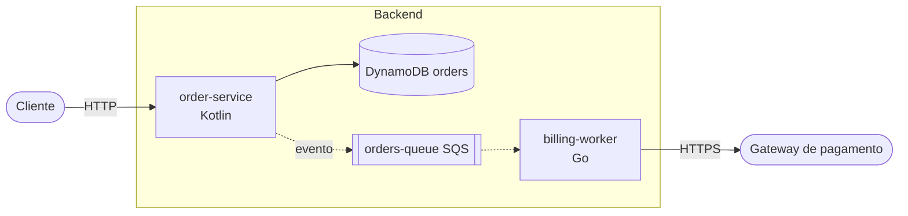

# Arquitetura simples em Mermaid

Fonte no `flow.md`: **Componentes** e **Integrações externas**.

## Mapeamento
- Cada componente vira um nó; o tipo vai no rótulo (`orderSvc["order-service Kotlin"]`).
- Fronteiras (serviço, domínio, conta) viram `subgraph`.
- Dependências viram setas com rótulo do protocolo (`-->|HTTP|`, `-.->|evento|` para assíncrono).
- Formas: bancos `[( )]`, filas `[[ ]]`, externos `([ ])`.

## Exemplo

## Limites (avise o usuário)
- Sem ícones AWS, sem grupos de conta, região, VPC ou subnets reais, e o layout é automático. Para infra, use a skill `drawio`.
- Passou de ~15 nós: divida por domínio e faça um diagrama de visão geral com os subgrafos colapsados em um nó cada.
