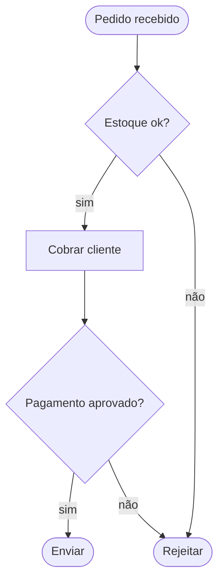

# Fluxogramas, processos e estados

Fonte no `flow.md`: só o fluxo pedido, na seção **Fluxos principais** (`### <nome do fluxo>`, com regras e decisões). É essa seção que o índice vigia.

## Mapeamento
- Início e fim: `([Início])`, `([Fim])`.
- Passo: `[texto]`. Decisão: `{pergunta?}` com arestas rotuladas (`-->|sim|`).
- Fases ou serviços diferentes viram `subgraph`.
- Ciclo de vida de uma entidade (pedido: criado → pago → enviado) vira `stateDiagram-v2`.

## Exemplo

## Cuidados
- Direção `TD` para processos curtos, `LR` para pipelines longos.
- Toda decisão tem todas as saídas rotuladas.
- Se o `flow.md` não diz o que acontece num ramo, não invente: ponha um nó `Lacuna: <dúvida>` ou pergunte ao usuário.
