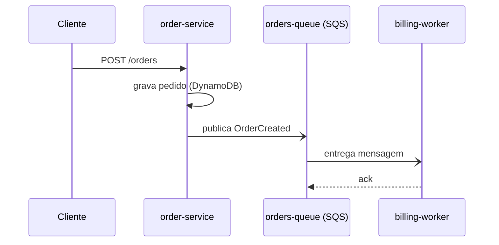

# Diagramas de sequência

Fonte no `flow.md`: seção **Fluxos principais** (um `###` por fluxo).

## Mapeamento
- Cada ator ou componente citado nos passos vira um `participant`.
- Cada passo numerado vira uma mensagem: `->>` (chamada), `-->>` (resposta), `-)` (assíncrona, fila ou evento).
- Passo condicional vira `alt/else`; repetição vira `loop`; paralelismo vira `par`.

## Exemplo

## Cuidados
- Declare `participant` na ordem em que aparecem no fluxo, da esquerda para a direita.
- Fluxo com mais de ~12 mensagens: divida por fase (`%% fase: cobrança`) ou em dois diagramas.
- Use `Note over A,B:` para marcar `[inferido]`.
